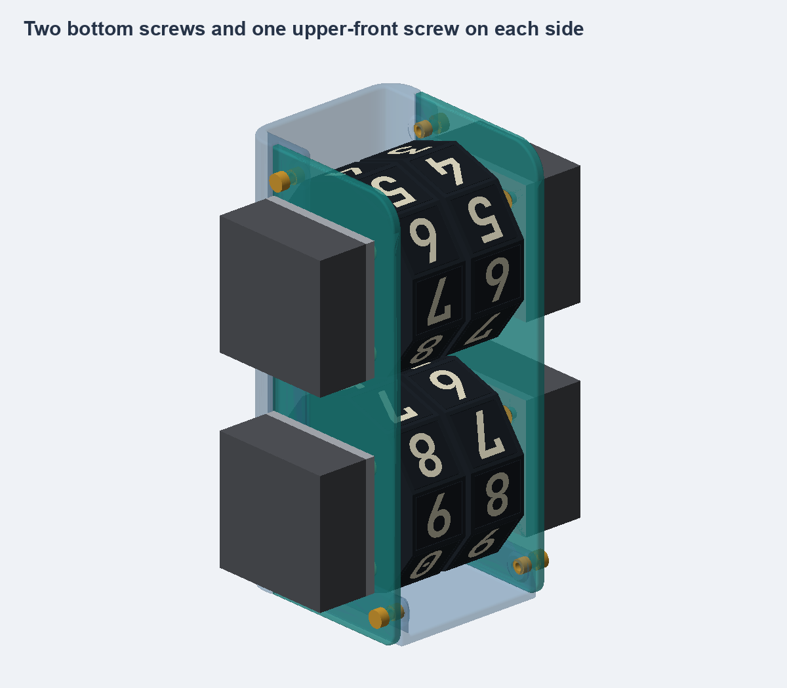

# Drum display

A 3D-printable 2×2 mechanical display with four direct-drive stepper motors and flat, multicolor JetBrains Mono digit tiles.

[**Explore the interactive gallery →**](https://raytallen.github.io/drum-display/)

## Files

- [Drum print files and source](outputs/flat_drum/)
- [Holder print files and source](outputs/rounded_holder/)
- [Standalone interactive HTML](docs/index.html) — download and open locally; images are embedded.
- [Project status](HANDOFF.md)

The drum has been printed successfully. The latest holder passed geometry and slicing checks; physical assembly is next. Electronics and firmware are still to come.
